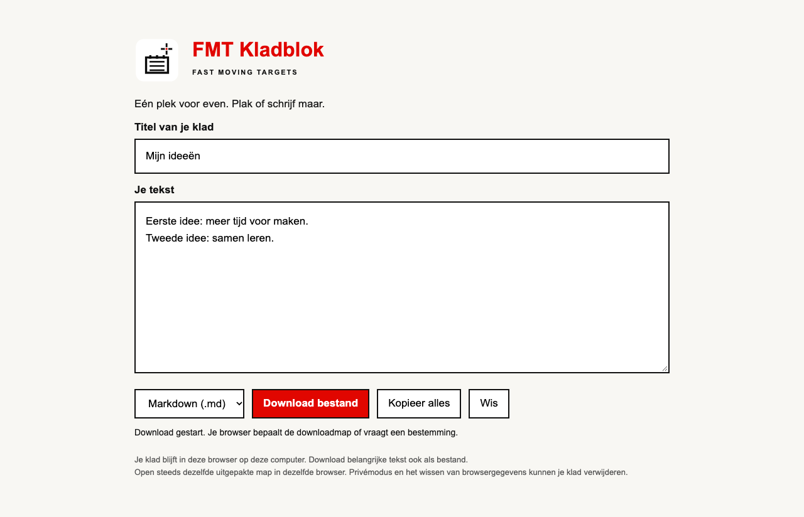

# FMT Kladblok

## Een plek voor je volgende idee

Schrijf een notitie, plak een tekst of werk een idee uit. Je klad wordt automatisch in je browser bewaard. Download je tekst zodra je hem ergens anders wilt gebruiken.

**[Download Kladblok voor Mac, Windows en Linux](https://github.com/erwinblom/kladblok/releases/download/v2.0.0/FMT-Kladblok-v2.0.0.zip)**

Gratis · Werkt offline · Geen account · Geen installatie

## In drie stappen aan de slag

1. Download de ZIP via de link hierboven.
2. Pak de hele ZIP uit in een vaste map op je computer.
3. Open **index.html** in Chrome of Edge en begin met schrijven.

Bewaar een bladwijzer naar dit bestand om je kladblok terug te vinden.

Deze browseruitgave is dezelfde op Mac, Windows en Linux. Gebruik steeds dezelfde browser, hetzelfde profiel en dezelfde uitgepakte map. Verplaatsen of een andere browser gebruiken kan een andere opslagplek opleveren. De browseruitgave heeft geen icoon in de systeemmenubalk.

## Je eerste klad

Vul een titel en wat tekst in. Wijzigingen worden automatisch lokaal in deze browser bewaard. Sluit de browser helemaal en open hetzelfde bestand weer: je klad komt terug.

Kies **Tekst (.txt)** of **Markdown (.md)** en klik **Download bestand**. De browser bewaart `Klad.txt` of `Klad.md` in je downloadmap, of vraagt waar je het wilt bewaren. Open het bestand om je uitvoer te controleren. Markdown zet `# ` voor de titel; je tekst blijft ongewijzigd. Beide bestanden zijn UTF-8.

**Kopieer alles** kopieert titel en tekst. Blokkeert je browser het klembord, selecteer en kopieer je tekst met Ctrl+C (Windows/Linux) of ⌘C (Mac). **Wis** vraagt bevestiging; **Herstel gewist klad** haalt de laatste gewiste titel en tekst tijdens dezelfde sessie terug.

## Waar blijft mijn tekst?

Alleen in de lokale browseropslag van dit bestand. Er is geen synchronisatie of verzending. Download belangrijke teksten ook als los bestand: privémodus, browsergegevens wissen of een browserprobleem kan je klad verwijderen. Een gedownload bestand blijft zelfstandig bruikbaar.

De eerdere native Mac-versie blijft beschikbaar in `Sources/`. Die bewaart haar eigen klad in `~/Library/Application Support/FMT Kladblok Open Source/kladblok.json`. Er is geen automatische migratie: kopieer je tekst uit die app naar deze browseruitgave. De persoonlijke Werkplaats-koppelingen zijn geen onderdeel van deze openbare tool.

## Waarom ik dit deel

Ik maakte dit met AI omdat ik het zelf nodig had. Ik ben geen programmeur en geen designer. Ik deel de software om je op gang te helpen: probeer haar, bouw erop voort en maak haar passend bij jouw werk.

## Zo pas je Kladblok aan

Je hoeft niet te kunnen programmeren om een kleine wijziging te proberen:

1. Maak een kopie van de hele uitgepakte map. Houd je werkende versie apart.
2. Open de kopie in een lokale AI-werkomgeving, bijvoorbeeld Codex. Of geef een nieuwe ChatGPT- of Claude-chat de bestanden `index.html` en deze README.
3. Vraag één concrete verandering, bijvoorbeeld een grotere letter, een donkere achtergrond of een extra knop.
4. Neem de gewijzigde bestanden terug, open `index.html` en test schrijven, downloaden en opnieuw openen.

**Kopieer deze opdracht naar je AI:**

> Dit is FMT Kladblok. Ik ben geen programmeur. Lees de bestanden en handleiding. Ik gebruik [Mac/Windows/Linux]. Verander alleen de rode knoppen naar blauw. Werk in een kopie en behoud schrijven, automatisch bewaren, kopiëren en tekst/Markdown-export. Geef het complete aangepaste bestand terug als je mijn lokale map niet kunt bewerken. Help me het te openen en testen. Publiceer of verstuur niets. Vertel wat je werkelijk hebt gecontroleerd.

Een gewone chat kan je computer niet vanzelf aanpassen. Werkt een download niet, vraag: “Noem de bestandsnaam, de exacte tekst die ik moet zoeken en de vervanging.” Geef bij problemen de volledige foutmelding door, zonder je privénotities of geheimen. `index.html` bevat interface en werking; de kleur staat bovenaan bij `--accent`.

## Laat Kladblok samenwerken met Werkplaats

**Snel iets opschrijven, daarna met één knop bewaren bij je andere notities.** Dat is een voorbeeld van hoe je met AI twee tools aan jouw manier van werken kunt aanpassen.

In mijn persoonlijke Mac-versie kies ik **Online** of **Offline** en klik ik op **Sla op in Werkplaats**. De titel en tekst gaan naar **Notities** in Werkplaats. Mijn klad blijft ook in Kladblok staan. Opnieuw bewaren werkt dezelfde notitie bij; een wijziging die ik in Werkplaats heb gemaakt wordt niet stil overschreven. Dit is een overdracht, geen automatische synchronisatie in twee richtingen.

**Deze koppeling is niet ingebouwd in de openbare Kladblok-download.** Het is een idee voor je eigen uitbreiding. De persoonlijke Mac-koppeling is niet zonder aanpassingen te gebruiken in de browserversie voor Mac, Windows en Linux.

### Probeer het met deze AI-opdracht

Maak eerst een kopie van Kladblok en geef je AI ook de broncode en handleiding van [Werkplaats](https://github.com/erwinblom/werkplaats). Gebruik een AI-omgeving die projectbestanden kan aanpassen, of vraag om het complete aangepaste project als download.

> Ik ben geen programmeur. Ik wil FMT Kladblok laten samenwerken met mijn Werkplaats, zodat ik mijn titel en tekst met één knop in Notities kan bewaren.
>
> Bekijk eerst beide projecten. Vraag welk systeem ik gebruik (Mac, Windows of Linux) en welke Werkplaats-versie (online of lokaal). Controleer welke verbinding die versie werkelijk ondersteunt. Verzin geen API, neem geen persoonlijke instellingen van de maker over en beloof niet dat de Mac-koppeling ongewijzigd in mijn browser werkt.
>
> Werk in een kopie. Voeg een knop ‘Sla op in Werkplaats’ toe. Laat me de juiste Werkplaats kiezen en onthoud die keuze. Bouw eerst de route die ik gebruik; voeg alleen een keuze Online/Offline toe als beide routes beschikbaar zijn.
>
> Bewaar titel en tekst in Notities. Behoud mijn klad lokaal, ook bij fouten. Voorkom dubbele notities bij opnieuw klikken. Overschrijf geen wijzigingen uit Werkplaats zonder mij te laten kiezen. Toon pas ‘Bewaard’ als titel en tekst echt zijn teruggelezen; maak duidelijk onderscheid tussen overgedragen en opgeslagen.
>
> Gebruik de normale aanmelding of mapkeuze. Zet geen wachtwoorden of sleutels in de broncode. Blijf bij mijn gekozen bestemming en schakel bij een fout niet automatisch naar een andere dienst over.
>
> Leg de benodigde instellingen eenvoudig uit en help me testen met een fictieve notitie: bewaren, terugvinden in Werkplaats, opnieuw bewaren zonder dubbeling, een wijziging in Werkplaats beschermen en beide apps sluiten en heropenen. Test ook een mislukte verbinding: mijn klad moet behouden blijven. Behoud de bestaande Kladblok-functies. Vertel wat werkelijk getest is en wat nog niet. Publiceer of verstuur niets buiten de gekozen Werkplaats.

Begin met een proefnotitie zonder privé-informatie. Kan jouw versie geen directe koppeling maken, laat de AI dat uitleggen. Je kunt je tekst voorlopig als Markdown downloaden en via de beschikbare import- of plakroute in Werkplaats zetten.

Voor gevorderden: de oude Mac-menubalkapp bouwen

De browserversie hierboven vraagt geen bouwtools. Voor de bestaande Mac-menubalkapp: installeer Apple Command Line Tools (`xcode-select --install`), open Terminal in deze map en voer `zsh bouw.sh` uit. Open daarna `FMT Kladblok.app`. Deze bronroute is alleen voor macOS en tekent lokaal ad hoc; het is geen genotariseerde download. De iconenfamilie staat in `Resources/` en blijft meegeleverd.

## Controle en vrijheid

De geautomatiseerde [platformcontrole](https://github.com/erwinblom/kladblok/actions/workflows/platforms.yml) test tekst- en Markdown-export op exacte bytes, volledig sluiten/heropenen van Chromium, annuleren van wissen en herstel. De workflow draait op Ubuntu 24.04, Windows Server 2022 en macOS 14. Een groene run bewijst deze routes op die systemen; geen fysieke beginnersproef of alle browsers. Raadpleeg de run bij de betreffende versie voor de daadwerkelijke uitslag.

Voor ontwikkelaars: Node.js 22, `npm ci`, `npx playwright install chromium`, `npm test`. Dit is alleen voor controles; dagelijks gebruik vraagt geen Node.js.

Code en documentatie: [MIT](LICENSE). FMT-naam en iconen: [merkvoorwaarden](MERKVOORWAARDEN.md). Je hoeft eigen wijzigingen niet terug te geven. Meld reproduceerbare problemen via [Issues](https://github.com/erwinblom/kladblok/issues).
