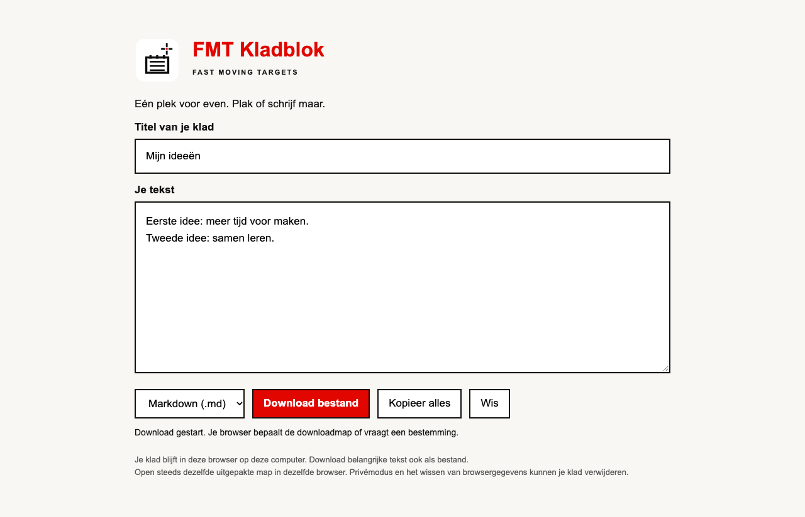

# FMT Kladblok

**Een plek voor je volgende idee: schrijf, plak en download je tekst.**

**[Download Kladblok voor Mac, Windows en Linux](https://github.com/erwinblom/kladblok/releases/download/v2.0.0/FMT-Kladblok-v2.0.0.zip)**

Gratis · Geen account · Geen installatie · Werkt offline

> **Dit is een half-product.** Het werkt zoals het is, en het is gemaakt om te veranderen. [Spring naar: maak het van jezelf](#maak-het-van-jezelf).

## Beginnen

1. Download de ZIP en pak hem helemaal uit in een vaste map.
2. Open **index.html** in Chrome of Edge.
3. Typ een titel en wat tekst. Je klad wordt vanzelf bewaard.

Zet een bladwijzer op het bestand om je kladblok terug te vinden.

## Wat kun je ermee

- **Schrijven en plakken.** Elke wijziging wordt automatisch in je browser bewaard.
- **Downloaden** als tekst (.txt) of Markdown (.md). Bij Markdown wordt je titel de kop.
- **Kopieer alles** zet titel en tekst op je klembord.
- **Wis** vraagt bevestiging. Met **Herstel gewist klad** haal je de tekst tijdens dezelfde sessie terug.

## Maak het van jezelf

De hele app is één bestand: `index.html`. Je hoeft niet te kunnen programmeren om er iets aan te veranderen.

**Zonder AI:** open `index.html` in een teksteditor. Bovenaan staat een blok INSTELLINGEN met kleuren en letters. Verderop staat een tweede blok met de naam, het logo en de bestandsnaam. Verander een waarde, bewaar en herlaad de pagina.

**Met AI als bouwmaatje:**

1. Maak een kopie van de uitgepakte map. Houd je werkende versie apart.
2. Open de kopie in een AI-werkomgeving zoals Codex of Claude Code. Of geef een chat de bestanden `index.html` en `AGENTS.md`.
3. Vraag één verandering en doorloop daarna de stappen onder Beginnen opnieuw.

Kopieer deze opdracht:

> Dit is FMT Kladblok. Ik ben geen programmeur. Lees eerst AGENTS.md en de README. Ik gebruik [Mac/Windows/Linux]. Mijn wens: [één verandering]. Werk in een kopie, behoud wat volgens AGENTS.md heel moet blijven en vertel wat je werkelijk hebt getest. Geef het complete aangepaste bestand terug als je mijn map niet kunt bewerken. Publiceer of verstuur niets.

**Ideeën, van makkelijk naar ambitieus:**

1. Een andere kleur of een grotere letter.
2. Je eigen naam en logo in plaats van FMT.
3. Een woordenteller of leestijd onder je tekst.
4. Een donkere weergave met een schakelaar.
5. Meerdere kladjes naast elkaar, met een lijstje om te wisselen.
6. Een knop die je klad doorzet naar je notities in Werkplaats. [Zo pak je dat aan](docs/KOPPELEN-MET-WERKPLAATS.md).

Een gewone chat verandert je bestanden niet vanzelf. Lukt een download niet, vraag dan: "Noem de exacte tekst die ik moet zoeken en de vervanging." Geef bij problemen de volledige foutmelding door, zonder je privénotities.

## Waar blijft mijn tekst

Alleen in de opslag van deze browser, op deze computer. Er wordt niets verstuurd of gesynchroniseerd. Dat is geen back-up: privémodus, browsergegevens wissen of de map verplaatsen kan je klad verwijderen. Download wat belangrijk is.

Gebruik steeds dezelfde browser, hetzelfde profiel en dezelfde map.

## Grenzen

- Eén klad tegelijk.
- Geen synchronisatie tussen apparaten of browsers.
- Getest in Chromium op Ubuntu 24.04, Windows Server 2022 en macOS 14. Zie de [platformcontrole](https://github.com/erwinblom/kladblok/actions/workflows/platforms.yml).
- De koppeling met Werkplaats uit mijn eigen versie zit niet in deze download.

## Als iets niet werkt

- **Mijn klad is weg.** Open hetzelfde bestand in dezelfde browser en hetzelfde profiel. Een andere map of browser heeft een eigen opslag.
- **Kopiëren lukt niet.** Selecteer je tekst en gebruik Ctrl+C of ⌘C.
- **Fout na een eigen wijziging.** Geef je AI de foutmelding en het gewijzigde bestand, of open je oorspronkelijke kopie.

[Probleem melden](https://github.com/erwinblom/kladblok/issues)

## Waarom ik dit deel

Ik maakte dit met AI omdat ik het zelf nodig had. Ik ben geen programmeur en geen designer. Ik deel de software om je op gang te helpen: probeer haar, bouw erop voort en maak haar passend bij jouw werk.

## Licentie en credits

Code en documentatie: [MIT](LICENSE). FMT-naam en iconen: [merkvoorwaarden](docs/MERKVOORWAARDEN.md). Je hoeft eigen wijzigingen niet terug te geven.

Voor gevorderden: de oudere Mac-menubalkapp staat in `Sources/` en bouw je met `zsh bouw.sh`. De controles draai je met Node.js 22, `npm ci`, `npx playwright install chromium` en `npm test`.
